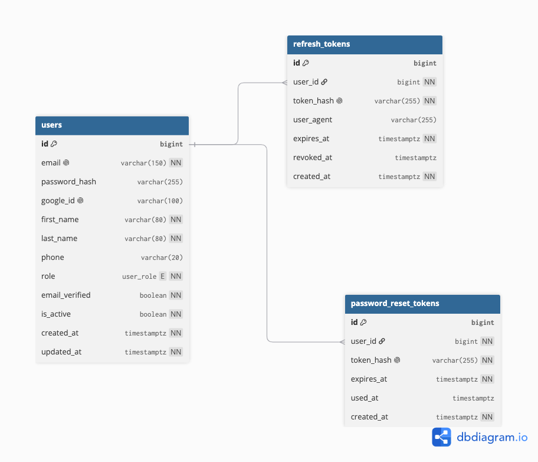

# Diagrama de base de datos — App e-commerce Salazar SAC

## Descripción

El diagrama es el modelo entidad-relación (ER) que se persiste en el contenedor **PostgreSQL** del [diagrama de despliegue](diagrama-de-despliegue.md) y que implementa la capa de **Repositorios (Spring Data JPA)** del [diagrama de arquitectura](diagrama-de-arquitectura.md). Corresponde a la historia técnica **HT-06** de la épica [E0. Fundamentos del proyecto](epicas.md#e0).

Por ahora modela el dominio de **autenticación y registro** (épica [E1](epicas.md#e1)) y el **catálogo** (épica [E2](epicas.md#e2), HU-07) y las **direcciones de entrega** del perfil (épica [E5](epicas.md#e5), HU-24); las tablas de carrito y pedidos se incorporarán en iteraciones posteriores de esta misma historia técnica.

### Tablas

- **users**: cuenta de cada persona que usa el sistema, sea Cliente o Administrador.
  - `email`, `password_hash`: credenciales para el login tradicional (HU-01, HU-02).
  - `google_id`: identificador devuelto por Google OAuth2 cuando el usuario se registra/inicia sesión con Google en lugar de contraseña (HU-06).
  - `first_name`, `last_name`, `phone`: datos solicitados al registrarse (HU-01) y editables luego desde el perfil (HU-23).
  - `role` (`user_role`): distingue Cliente de Administrador, para que el panel de administración exija este rol al iniciar sesión (HU-28). El primer administrador lo crea el backend al arrancar si no existe ninguno, con datos de configuración (HT-11).
  - `email_verified`: soporta la validación del correo en el registro (HU-01).
  - `is_active`: permite desactivar una cuenta sin eliminar su historial de pedidos.
  - `created_at`, `updated_at`: trazabilidad estándar de auditoría.

- **refresh_tokens**: sesiones activas de un usuario, una fila por dispositivo/sesión.
  - `user_id`: referencia a `users`, quién es dueño de la sesión.
  - `token_hash`: valor del refresh token almacenado de forma segura (hash, no en texto plano), usado para renovar el JWT sin pedir credenciales de nuevo (HU-04, "mantener mi sesión iniciada").
  - `user_agent`: identifica el dispositivo/navegador de la sesión, útil si el cliente usa varios dispositivos.
  - `expires_at`: vencimiento natural de la sesión.
  - `revoked_at`: se marca al cerrar sesión manualmente (HU-05), invalidando el token aunque no haya expirado aún — clave para proteger la cuenta en un dispositivo compartido.

- **password_reset_tokens**: solicitudes de recuperación de contraseña (HU-03).
  - `user_id`: a quién pertenece la solicitud.
  - `token_hash`: token de un solo uso enviado por correo (vía el servidor SMTP del diagrama de despliegue) para autorizar el cambio de contraseña.
  - `expires_at`: ventana de validez del enlace de recuperación, por seguridad.
  - `used_at`: marca cuándo se consumió el token, para impedir que se reutilice.

- **categories**: agrupa los platos de la carta (HU-07).
  - `name`: nombre visible (único sin distinguir mayúsculas).
  - `slug`: identificador único para la URL del frontend (`/menu/ceviches`). El administrador puede editarlo (HU-31); renombrar la categoría no lo cambia, y el `slug` que tenía antes deja de resolver (sin redirección).

- **products**: platos que se muestran en el catálogo (HU-07).
  - `name`, `description`, `price`: datos que ve el cliente (`price` en soles con dos decimales).
  - `category_id`: referencia a `categories`; un plato pertenece a una sola categoría.
  - `rating`: calificación promedio de 0.0 a 5.0 (un decimal); `NULL` si aún no tiene.
  - `is_active`: un plato inactivo no aparece en el catálogo.
  - `is_available`: si el plato se puede pedir hoy (por defecto `true`). Un plato agotado sigue visible en el catálogo y su detalle lo indica (HU-10); el administrador lo cambia en HU-30.
  - `stock`: unidades que se pueden pedir hoy (entero mayor o igual que 0, por defecto 0). Un plato se puede pedir solo si `is_available` es `true` y `stock > 0`; la cantidad máxima en el carrito es el stock (HU-12). El administrador lo cambia en HU-29/HU-30 y el checkout lo descontará.
  - `created_at`: fecha de creación.

- **product_images**: imágenes de un plato, guardadas en el almacenamiento de objetos S3 (Garage; HU-07, HU-08).
  - `product_id`: plato al que pertenece; se borran en cascada con el plato.
  - `path`: clave del objeto dentro del bucket de imágenes, no la URL completa (la URL pública la arma el backend).
  - `position`: orden dentro del plato; la de menor posición es la imagen principal.
  - `created_at`: fecha en que se registró la imagen.

- **addresses**: direcciones de entrega guardadas por un cliente (HU-24).
  - `user_id`: referencia a `users`, dueño de la dirección. Sin borrado en cascada: las cuentas se desactivan, no se borran, y los pedidos seguirán referenciando la dirección.
  - `label`: nombre que el cliente da a la dirección ("Casa", "Trabajo"), hasta 40 caracteres.
  - `address`, `reference`: dirección escrita (hasta 200 caracteres) y referencia opcional para el repartidor.
  - `latitude`, `longitude`: coordenadas fijadas en el mapa (`NUMERIC(9,6)`, ~0.1 m); el punto por defecto es el Centro de Lima.
  - `deleted_at`: borrado lógico (soft delete). Una dirección eliminada deja de ser visible para el cliente pero la fila se conserva; las consultas filtran `deleted_at IS NULL`. El cliente puede tener hasta 10 direcciones activas.
  - `created_at`, `updated_at`: trazabilidad estándar.

### Relaciones

- `users (1) — (N) refresh_tokens`: un usuario puede tener varias sesiones/dispositivos activos a la vez.
- `users (1) — (N) password_reset_tokens`: un usuario puede generar varias solicitudes de recuperación a lo largo del tiempo (por ejemplo, si no completa una anterior).
- `users (1) — (N) addresses`: un cliente guarda varias direcciones de entrega.
- `categories (1) — (N) products`: una categoría agrupa varios platos; cada plato pertenece a una sola categoría.
- `products (1) — (N) product_images`: un plato tiene una o más imágenes; la de menor `position` es la principal.

La búsqueda de platos por nombre (HU-09) usa la extensión `unaccent` de PostgreSQL (migración `V4__product_search.sql`) para no distinguir tildes; no agrega tablas ni columnas.
