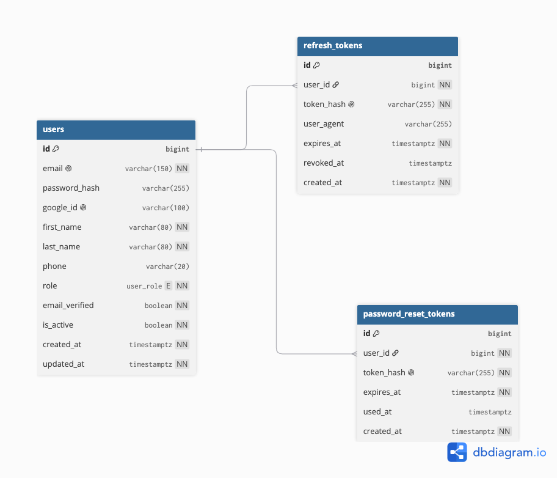

# Diagrama de base de datos — App e-commerce Salazar SAC

## Descripción

El diagrama es el modelo entidad-relación (ER) que se persiste en el contenedor **PostgreSQL** del [diagrama de despliegue](diagrama-de-despliegue.md) y que implementa la capa de **Repositorios (Spring Data JPA)** del [diagrama de arquitectura](diagrama-de-arquitectura.md). Corresponde a la historia técnica **HT-06** de la épica [E0. Fundamentos del proyecto](epicas.md#e0).

Por ahora modela el dominio de **autenticación y registro** (épica [E1](epicas.md#e1)) y el **catálogo** (épica [E2](epicas.md#e2), HU-07) y las **direcciones de entrega** del perfil (épica [E5](epicas.md#e5), HU-24); los **pedidos y pagos** (épica [E4](epicas.md#e4), HU-19) se agregan en la migración `V10__orders.sql` y la etapa de entrega (HU-25) en `V12__order_delivery_status.sql`; la marca del correo de confirmación (HU-21) en `V13__order_confirmation_sent.sql`. El carrito no se persiste en la base de datos: vive en el navegador.

### Tablas

- **users**: cuenta de cada persona que usa el sistema, sea Cliente o Administrador.
  - `email`, `password_hash`: credenciales para el login tradicional (HU-01, HU-02).
  - `google_id`: identificador devuelto por Google OAuth2 cuando el usuario se registra/inicia sesión con Google en lugar de contraseña (HU-06).
  - `first_name`, `last_name`, `phone`: datos solicitados al registrarse (HU-01) y editables luego desde el perfil (HU-23).
  - `role` (`user_role`): distingue Cliente de Administrador, para que el panel de administración exija este rol al iniciar sesión (HU-28). El primer administrador lo crea el backend al arrancar si no existe ninguno, con datos de configuración (HT-11).
  - `email_verified`: soporta la validación del correo en el registro (HU-01).
  - `is_active`: permite desactivar una cuenta sin eliminar su historial de pedidos.
  - `created_at`, `updated_at`: trazabilidad estándar de auditoría.

- **refresh_tokens**: sesiones activas de un usuario, una fila por dispositivo/sesión.
  - `user_id`: referencia a `users`, quién es dueño de la sesión.
  - `token_hash`: valor del refresh token almacenado de forma segura (hash, no en texto plano), usado para renovar el JWT sin pedir credenciales de nuevo (HU-04, "mantener mi sesión iniciada").
  - `user_agent`: identifica el dispositivo/navegador de la sesión, útil si el cliente usa varios dispositivos.
  - `expires_at`: vencimiento natural de la sesión.
  - `revoked_at`: se marca al cerrar sesión manualmente (HU-05), invalidando el token aunque no haya expirado aún — clave para proteger la cuenta en un dispositivo compartido.

- **password_reset_tokens**: solicitudes de recuperación de contraseña (HU-03).
  - `user_id`: a quién pertenece la solicitud.
  - `token_hash`: token de un solo uso enviado por correo (vía el servidor SMTP del diagrama de despliegue) para autorizar el cambio de contraseña.
  - `expires_at`: ventana de validez del enlace de recuperación, por seguridad.
  - `used_at`: marca cuándo se consumió el token, para impedir que se reutilice.

- **categories**: agrupa los platos de la carta (HU-07).
  - `name`: nombre visible (único sin distinguir mayúsculas).
  - `slug`: identificador único para la URL del frontend (`/menu/ceviches`). El administrador puede editarlo (HU-31); renombrar la categoría no lo cambia, y el `slug` que tenía antes deja de resolver (sin redirección).

- **products**: platos que se muestran en el catálogo (HU-07).
  - `name`, `description`, `price`: datos que ve el cliente (`price` en soles con dos decimales).
  - `category_id`: referencia a `categories`; un plato pertenece a una sola categoría.
  - `rating`: calificación promedio de 0.0 a 5.0 (un decimal); `NULL` si aún no tiene.
  - `is_active`: un plato inactivo no aparece en el catálogo.
  - `is_available`: si el plato se puede pedir hoy (por defecto `true`). Un plato agotado sigue visible en el catálogo y su detalle lo indica (HU-10); el administrador lo cambia en HU-30.
  - `stock`: unidades que se pueden pedir hoy (entero mayor o igual que 0, por defecto 0). Un plato se puede pedir solo si `is_available` es `true` y `stock > 0`; la cantidad máxima en el carrito es el stock (HU-12). El administrador lo cambia en HU-29/HU-30 y el checkout lo descontará.
  - `created_at`: fecha de creación.
  - `deleted_at`: borrado lógico (soft delete, HU-29). Un plato eliminado deja de aparecer en la tienda y en el panel, pero la fila y sus imágenes se conservan para los pedidos históricos; las consultas filtran `deleted_at IS NULL`. Sigue referenciando su categoría, así que cuenta para impedir eliminarla (HU-31).

- **product_images**: imágenes de un plato, guardadas en el almacenamiento de objetos S3 (Garage; HU-07, HU-08).
  - `product_id`: plato al que pertenece; se borran en cascada con el plato.
  - `path`: clave del objeto dentro del bucket de imágenes (`products/{uuid}.{ext}`, generada por el backend al subirla en HU-29), no la URL completa (la URL pública la arma el backend).
  - `position`: orden dentro del plato; la de menor posición es la imagen principal.
  - `created_at`: fecha en que se registró la imagen.

- **addresses**: direcciones de entrega guardadas por un cliente (HU-24).
  - `user_id`: referencia a `users`, dueño de la dirección. Sin borrado en cascada: las cuentas se desactivan, no se borran, y los pedidos seguirán referenciando la dirección.
  - `label`: nombre que el cliente da a la dirección ("Casa", "Trabajo"), hasta 40 caracteres.
  - `address`, `reference`: dirección escrita (hasta 200 caracteres) y referencia opcional para el repartidor.
  - `latitude`, `longitude`: coordenadas fijadas en el mapa (`NUMERIC(9,6)`, ~0.1 m); el punto por defecto es el Centro de Lima.
  - `deleted_at`: borrado lógico (soft delete). Una dirección eliminada deja de ser visible para el cliente pero la fila se conserva; las consultas filtran `deleted_at IS NULL`. El cliente puede tener hasta 10 direcciones activas.
  - `created_at`, `updated_at`: trazabilidad estándar.

- **delivery_zones**: zonas de precio del delivery que el administrador dibuja sobre un mapa (HU-37).
  - `name`: nombre de la zona, hasta 60 caracteres, único sin distinguir mayúsculas (`uq_delivery_zones_name_lower`).
  - `price`: tarifa de delivery en soles (`NUMERIC(4,2)`, mayor que 0 y hasta 99.99).
  - `color`: id del color de la paleta del design system con que se dibuja la zona (`celeste`, `naranja`, `lima`, `aji`, `coral`, `grafito`).
  - `area`: polígono de la zona (`geometry(Polygon, 4326)` de PostGIS, latitud/longitud WGS 84) con índice GIST; un `CHECK (ST_IsValid(area))` impide polígonos con lados cruzados. Las zonas pueden superponerse.
  - `active`: si la zona se usa para cobrar el delivery (por defecto `true`). Una zona inactiva conserva su dibujo y tarifa.
  - `created_at`, `updated_at`: trazabilidad estándar. Eliminar una zona borra la fila (todavía nada la referencia).

- **orders**: pedido de un cliente (HU-19 y HU-20; confirmación por pantalla y por correo en HU-21).
  - `code`: código de pedido legible (`SAL-001042`), único y correlativo; sale de la secuencia `order_code_seq`.
  - `delivery_code`: 4 dígitos aleatorios que el cliente le dice al repartidor (o en tienda, con Recojo) para confirmar la entrega. Se guarda en claro, a diferencia de los tokens, porque hay que poder mostrárselo otra vez; la API solo lo devuelve al dueño con el pedido confirmado (`PAGADO` o `PENDIENTE_COBRO`).
  - `user_id`: cliente dueño; sin cascada.
  - `status`: `PENDIENTE_PAGO` (pago en línea sin completar), `PENDIENTE_COBRO` (contraentrega confirmada, se paga al recibir; no vence), `PAGADO` o `CANCELADO`. `payment_method`: `ONLINE` o `CONTRAENTREGA`. `delivery_type`: `ENTREGA` o `RECOJO`.
  - `delivery_status`: etapa de la entrega, `EN_PREPARACION` (valor inicial), `EN_CAMINO` o `ENTREGADO` (HU-25). Es independiente de `status`, que solo describe el pago; el historial del cliente lista los pedidos comprados (`PAGADO` o `PENDIENTE_COBRO`) ordenados por `COALESCE(paid_at, created_at)`, con un índice parcial para ese orden.
  - `address_id` y la copia `address_label`, `address_text`, `address_reference`, `address_latitude`, `address_longitude`, `delivery_zone_name`: la dirección y la zona al momento de comprar; solo con Entrega (`CHECK`). La copia evita que editar o eliminar la dirección altere el pedido.
  - `subtotal`, `discount`, `delivery_price`, `total` (`NUMERIC(10,2)`): importes calculados en el servidor, nunca recibidos del cliente.
  - `collection_method` (`EFECTIVO` o `YAPE`) y `cash_amount`: solo con contraentrega (`CHECK`); el monto, opcional y solo con efectivo, es con cuánto pagará el cliente y nunca es menor al total. El vuelto no se guarda: se calcula como `cash_amount - total`.
  - `expires_at`: plazo para pagar (30 minutos); vacío en la contraentrega. `created_at` es la fecha de compra y `paid_at` la de pago (la aprobación de Mercado Pago; vacía en la contraentrega hasta que se cobre). `cancelled_at` y `cancel_reason` (`REEMPLAZADO`, `VENCIDO`, `ERROR_PASARELA`).
  - `confirmation_sent_at`: se marca de forma atómica cuando se reclama el envío del correo de confirmación (HU-21), de modo que un pedido nunca lo envía dos veces. Los pedidos anteriores a HU-21 quedan vacíos y no reciben correo.
  - `preference_id`, `init_point`: la preferencia de Mercado Pago y la URL de pago, para depurar.

- **order_items**: platos de un pedido, con copia de `product_name`, `unit_price`, `quantity` y `line_total`, de modo que cambiar el catálogo no altera pedidos pasados. Se borran en cascada con el pedido; `product_id` referencia `products` sin cascada.

- **payments**: intentos de pago registrados por el webhook de Mercado Pago.
  - `order_id`, `provider` (`MERCADOPAGO`) y `provider_payment_id`, con restricción única `(provider, provider_payment_id)`: hace idempotente el procesamiento de avisos repetidos.
  - `status` y `status_detail`: lo que informa el proveedor (`approved`, `rejected`, ...). `amount`.
  - `needs_review`: se marca cuando un pago aprobado no cuadra con el pedido (importe distinto, pedido ya vencido o pago doble) y requiere revisión manual.

### Relaciones

- `users (1) — (N) refresh_tokens`: un usuario puede tener varias sesiones/dispositivos activos a la vez.
- `users (1) — (N) password_reset_tokens`: un usuario puede generar varias solicitudes de recuperación a lo largo del tiempo (por ejemplo, si no completa una anterior).
- `users (1) — (N) addresses`: un cliente guarda varias direcciones de entrega.
- `categories (1) — (N) products`: una categoría agrupa varios platos; cada plato pertenece a una sola categoría.
- `products (1) — (N) product_images`: un plato tiene una o más imágenes; la de menor `position` es la principal.
- `users (1) — (N) orders`: un cliente hace varios pedidos.
- `orders (1) — (N) order_items`: un pedido tiene uno o más platos.
- `products (1) — (N) order_items`: un plato aparece en muchos pedidos.
- `addresses (1) — (N) orders`: una dirección puede usarse en varios pedidos (opcional: el Recojo no tiene dirección).
- `orders (1) — (N) payments`: un pedido puede tener varios intentos de pago.

La búsqueda de platos por nombre (HU-09) usa la extensión `unaccent` de PostgreSQL (migración `V4__product_search.sql`) para no distinguir tildes; no agrega tablas ni columnas.

Las zonas de delivery (HU-37) usan la extensión **PostGIS** (migración `V8__postgis.sql`), por lo que la base corre sobre una imagen de PostgreSQL con PostGIS (`docker/postgres/Dockerfile`).
